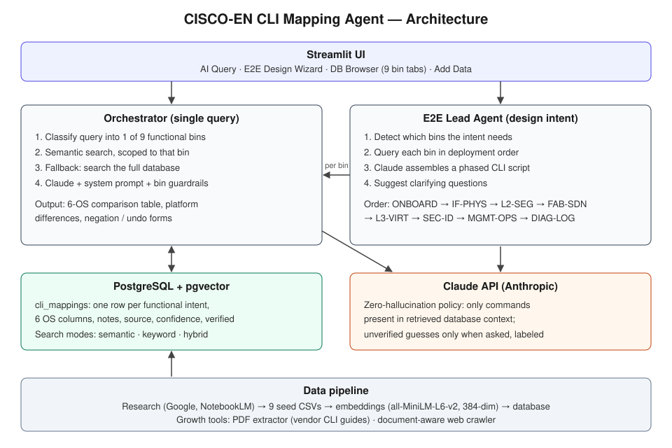

# CISCO-EN CLI Mapping Agent (showcase)

A RAG-powered web app that translates network CLI commands between Cisco and Extreme operating systems. It maps the operational intent of a command, not its literal text, across six OSes organized into nine functional groups ("bins").

This repository describes the project. The source code is kept private.

## The problem

In a multi-vendor migration, the same outcome is configured very differently on each platform: NX-OS needs `feature` commands before a protocol can be configured, Switch Engine (EXOS) uses flat verb-noun syntax with no interface sub-mode, and Fabric Engine (VOSS) segments Layer 2 with I-SIDs. So the agent does not translate text line by line; it maps the operational end state the engineer is trying to reach.

## What it does

- **AI Query:** ask in plain English. The agent returns a comparison table across all six OSes, key platform differences, and the negation (undo) form of each command.
- **E2E Design Wizard:** describe a network design intent (for example, a campus with a Fabric Engine core, OSPF and 802.1X). A lead agent breaks it into configuration phases and produces an ordered CLI script, followed by verification commands and clarifying questions.
- **DB Browser:** browse, filter and download the mapping database by functional bin.
- **Add Data:** upload vendor documents (PDF/TXT) or CSVs, or run the web crawler. New data is previewed and approved before it is inserted.

## OS coverage

| Vendor | OS |
|---|---|
| Cisco | IOS (classic) |
| Cisco | IOS-XE 17.x (Catalyst 9000) |
| Cisco | NX-OS 10.x (Nexus) |
| Extreme | Switch Engine (formerly EXOS) 33.x |
| Extreme | Fabric Engine (formerly VOSS) 9.x |
| Extreme | SLX-OS 20.x |

## Nine functional bins

| Bin | Scope |
|---|---|
| `[ONBOARD]` | Factory reset, ZTP, boot flags, initial login, Zero Touch Fabric |
| `[SEC-ID]` | AAA, TACACS+, RADIUS, 802.1X, TrustSec/ONEPolicy, SGT/GBP |
| `[SYS-INFO]` | show version, inventory, environment, CPU, memory, hardware |
| `[IF-PHYS]` | Port speed/duplex, enable/disable, PoE, mirroring, stacking, LAG |
| `[L2-SEG]` | VLAN create/assign, trunk/access, STP, RSTP, MSTP, EAPS, LLDP, CDP |
| `[FAB-SDN]` | IS-IS, SPBM, LISP, VXLAN, I-SID, VNI, Fabric Attach, SD-Access |
| `[L3-VIRT]` | IP addressing, OSPF, BGP, RIP, VRRP, static routes, VRF, VSN |
| `[DIAG-LOG]` | ping, traceroute, debug, l2tracetree, show log, show counters |
| `[MGMT-OPS]` | Save config, NTP, SNMP, Syslog, backup/restore, RMON, licensing |

## How it works

**Single query (orchestrator)**
1. Classifies the query into one of the nine bins.
2. Runs a vector similarity search scoped to that bin. If the bin returns nothing, it falls back to a full-database search and flags that in the answer.
3. Sends the retrieved mappings to Claude with a master system prompt plus the bin's own guardrail prompt.

**Design intent (E2E lead agent)**
1. Detects which bins the intent needs.
2. Queries each bin in deployment order: ONBOARD → IF-PHYS → L2-SEG → FAB-SDN → L3-VIRT → SEC-ID → MGMT-OPS → DIAG-LOG.
3. Claude assembles a phase-by-phase script, flagging NX-OS `feature` prerequisites and Fabric Engine Zero Touch Fabric specifics.

## Design decisions

- **Intent mapping, not text translation.** Each database row is one functional intent with a column per OS, so the answer starts from what the engineer wants to achieve.
- **Zero-hallucination policy.** The model may only output commands present in the retrieved database context. Anything missing is marked as not in the database. A best guess is given only when the user explicitly asks for one, and it is labeled as unverified.
- **Bin-scoped retrieval with fallback.** Search runs inside the detected bin first; if nothing is found, a full-database fallback catches commands that may be filed under a different bin.
- **Tuned for terse queries.** The similarity threshold is set lower than typical because CLI queries are short.
- **Human approval for new data.** Data added from documents, CSVs or the crawler is previewed and approved before it reaches the database. Rows carry a confidence score and a verified flag, and searches can be limited to verified rows.

## Example mapping

Intent: **Create VLAN** (`[L2-SEG]`)

| OS | Command |
|---|---|
| IOS-XE | `vlan <id>` → `name <name>` |
| NX-OS | `vlan <id>` → `name <name>` |
| Switch Engine (EXOS) | `create vlan <name> tag <id>` |
| Fabric Engine (VOSS) | `vlan create <id> name <name> type port-mstprstp 0` |
| SLX-OS | `vlan <id>` → `name <name>` |

Note stored with the mapping: EXOS takes the name first, then the tag; on VOSS, `type` specifies the STP instance.

## Tech stack

Python · Streamlit · Anthropic Claude API · PostgreSQL + pgvector · SQLAlchemy · sentence-transformers (all-MiniLM-L6-v2) · pdfplumber / PyMuPDF · httpx + BeautifulSoup · Railway

Built with Claude Code. The mapping data was researched with Google search and Google NotebookLM against the vendors' published documentation.

## Screenshots

<!-- Add screenshots here, e.g.:

-->

---

© 2026 Khursheed Khan. All rights reserved.
